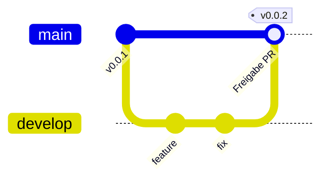

# Git-Workflow: nur GitHub / Cloud Agent (kein lokales Pflicht-Repo)

Du entwickelst **ausschließlich** im Monorepo auf GitHub — idealerweise per **Cloud Agent**, der `develop` checkt aus und per Pull Request nach `release` freigibt.

## Branch-Modell



| Branch | Zweck | Wer schreibt? |
|--------|--------|----------------|
| **`develop`** | Laufende Entwicklung, Experimente, Agent-Arbeit | Cloud Agent, du (via PR auf `develop`) |
| **`release`** | Freigegebener Stand, **GitHub Releases / Tags `v*`** | Nur nach deiner Freigabe (`develop` → `release`) |
| **`main`** | Legacy-Alias: zeigt auf denselben Stand wie `release` beim ersten Push; danach optional `main` löschen und nur `release` nutzen | Nur Promotion |

**Regel:** Alles Neue landet zuerst auf **`develop`**. **`release`** ändert sich nur durch einen von dir genehmigten Merge/PR.

## Cloud Agent (dein Normalfall)

1. Agent an **Repository:** `Gegels/openrailworks` starten.
2. **Default Branch in GitHub:** `develop` setzen (Settings → General → Default branch).
3. Agent arbeitet auf `develop`, committet und pusht dorthin.
4. CI läuft bei jedem Push auf `develop` und `release`.

## Freigabe nach `release` (ohne lokales Git nötig)

**Empfohlen — GitHub UI:**

1. **Pull requests** → **New PR**
2. **Base:** `release` ← **Compare:** `develop`
3. Titel z. B. `Release: promote develop → release`
4. CI muss grün sein → **Merge** (du gibst frei)
5. Optional: auf Branch `release` Tag setzen (`v0.0.2`) → löst Release-Workflow aus

**Alternativ (Agent mit Schreibrecht auf `release`):**

```bash
./scripts/promote-to-release.sh
```

Nur wenn du dem Agent explizit sagst: „Promote develop to release“ — sonst immer PR.

## Ersteinrichtung GitHub (einmalig)

Noch kein Code auf GitHub? Siehe [WINDOWS_FIRST_PUSH.md](WINDOWS_FIRST_PUSH.md) **einmalig** pushen (oder Deploy Key / `GH_TOKEN`), danach **nur noch Cloud Agent**.

Danach in GitHub:

| Setting | Empfehlung |
|---------|------------|
| Default branch | `develop` |
| Branch protection `release` | PR required, CI required, keine direkten Pushes |
| Branch protection `develop` | Optional: CI required |

## Tags & Versionen

- Tags **`v*`** nur auf **`release`** (Stable).
- Beta: Pre-releases von Tags auf `develop` optional später (Tag `v0.1.0-beta.1` auf `develop` — nur wenn du es willst).

## Monorepo

Ein Repo, ein Issue-Tracker, ein CI-Lauf pro Push — siehe [MONOREPO.md](MONOREPO.md).
